# 03: Amazon EC2 Instances

Hands-on labs from the AWS re/Start program, all about launching and running EC2 instances. Region: us-west-2 (Oregon).

I completed these exercises for the course first, then redid them from scratch so I could document each step with screenshots.

| Exercise | What it covers | Status |
|---|---|---|
| 1 | Guided EC2 lab: bastion host, launching a web server from the CLI, and fixing why the page wouldn't load | Documented below |
| 2 | EC2 Instance Challenge: build a VPC and a web server with no step by step guide | Documented below |
| 3 | Troubleshooting: launch a LAMP server with the AWS CLI from a script that has 2 hidden bugs | Documented below |

---

## Exercise 1: Creating Amazon EC2 Instances

### The goal

Launch a bastion host in the console, use it to launch a web server with the AWS CLI, and work out why the web server wasn't reachable from my browser. A bastion host is a small server you log in to first and then use as a jumping point to reach other resources.

### Part 1: The bastion host

I launched the bastion host from the console into a VPC the lab had already built (`Lab VPC`, `10.0.0.0/16`):

- Public subnet (`10.0.0.0/24`) with auto-assign public IP set to Enable
- No key pair
- A new security group, `bastion security group`, allowing SSH (port 22) from Anywhere
- The lab's `Bastion-Role` IAM instance profile attached under Advanced details, which lets the instance make AWS CLI calls without me typing in any keys

The yellow warning in the screenshot is AWS flagging that SSH is open to `0.0.0.0/0`. Fine for a short lab, and something I would restrict to known IP addresses anywhere that matters.

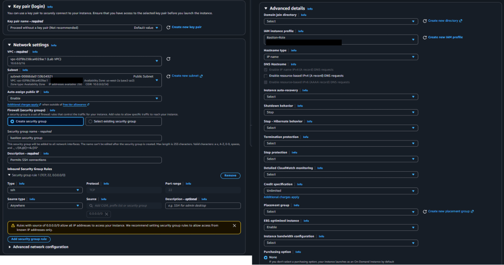

### Part 2: Launching the web server from the CLI

From a terminal on the bastion host, I used a short script to look up what the launch command needs, then ran `aws ec2 run-instances`:

- `AMI`: the latest Amazon Linux 2 AMI, pulled from an SSM parameter
- `SUBNET`: the ID of the subnet named `Public Subnet`
- `SG`: a security group whose name contains `web`
- The launch itself: `t3.micro`, a user data file, and a `Name` tag of `web server`

The command returned an instance ID, so the instance launched. Two things in the output are worth noticing. The `SG:` line came back blank, so the security group lookup found nothing. And there is a bash error on the region line (`substring expression < 0`).

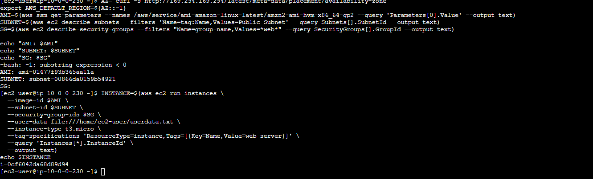

### Part 3: The page wouldn't load

My first attempt to open the web server in a browser failed with `ERR_NAME_NOT_RESOLVED`. The hostname in the error is just `us-west-2.compute.amazonaws.com`, which is missing the instance specific part at the front, so the browser had nothing to look up.

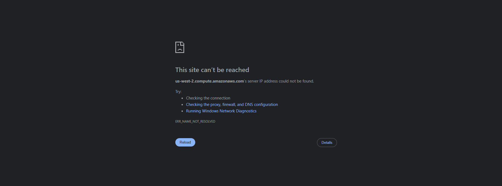

### Part 4: The fix

The web server also needed HTTP allowed through its security group. I added an inbound HTTP rule on port 80 to the default security group of `Lab VPC`. The rule list now shows HTTP (TCP, port 80) next to the default All traffic rule.

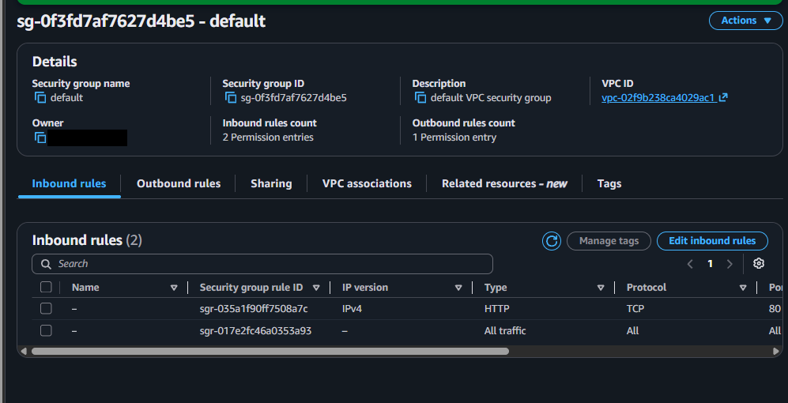

After that, the page loaded: the default Apache test page, which means Apache was installed and running on the instance.

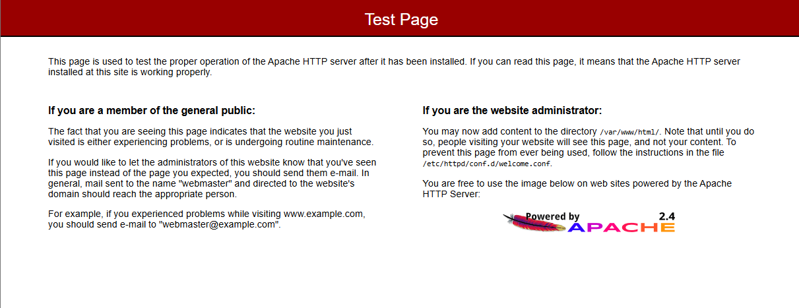

### What I learned

- **Read the output of every lookup before running the command that uses it.** My `SG:` line came back blank, and the launch still went through, so the instance may not have landed in the security group I meant it to.
- **Security groups block inbound traffic by default.** A running web server is not reachable until the right port (80 for HTTP) is allowed.
- **Different errors point to different problems.** `ERR_NAME_NOT_RESOLVED` means the address itself could not be found. That is not the same as a timeout (traffic blocked) or a refusal (nothing listening).
- **A bastion host plus an IAM role lets you run CLI commands from inside AWS** without putting access keys on the machine.

---

## Exercise 2: EC2 Instance Challenge

### The goal

Build a working web server on Amazon Linux without step by step instructions. The lab only gives high level requirements:

- A new VPC and a new subnet
- A T3 instance smaller than medium, with an auto-assigned public IPv4 address
- Install and start `httpd` (Apache) through user data, with write permission on `/var/www/html`
- gp2 root volume
- SSH access for EC2 Instance Connect
- Proof that `httpd` installed (system log), and a custom web page served from the instance

### What I built

| Resource | Name | Settings |
|---|---|---|
| VPC | lab vpc | `10.0.0.0/16` |
| Internet gateway | lab IGW | Attached to lab vpc |
| Subnet | lab subnet | `10.0.1.0/24`, us-west-2a |
| Route table | lab public rt | `0.0.0.0/0` to lab IGW, explicitly associated with lab subnet |
| Security group | web sg | Inbound SSH (22) and HTTP (80) |
| EC2 instance | web server | t3.micro, Amazon Linux 2023, 8 GiB gp2, auto-assign public IP on, no key pair, no IAM role |

### Part 1: The network

I created the VPC first. It is the private network everything else lives in.

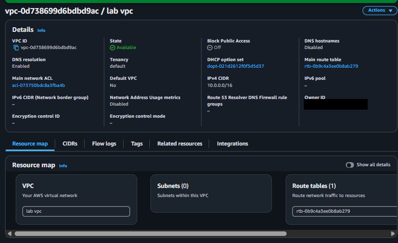

Then the internet gateway, and attached it to the VPC. A new internet gateway starts out detached, so the attach step matters.

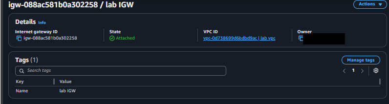

Then the subnet, a smaller slice of the VPC's address range. It shows 251 usable addresses because AWS reserves 5 in every subnet.

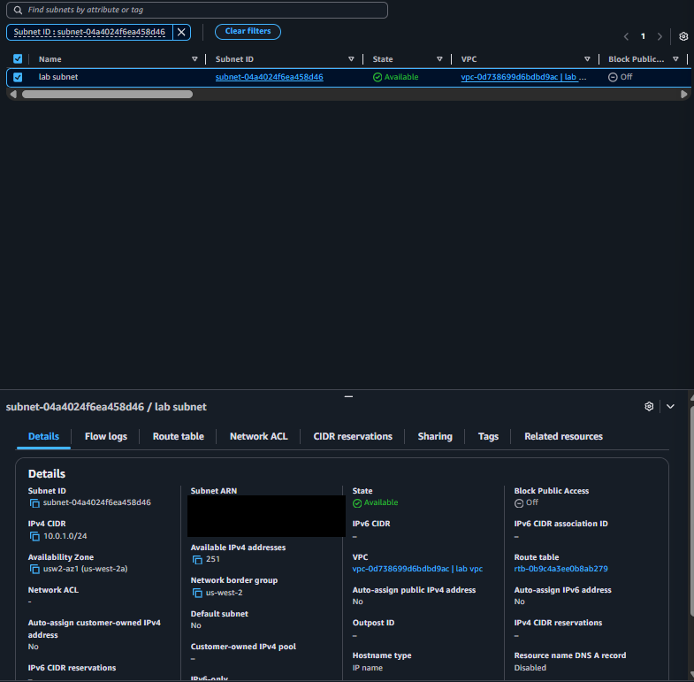

A subnet is not public just because it exists. It needs a route to the internet gateway. I made a new route table with `0.0.0.0/0` pointing to the IGW (the `10.0.0.0/16` local route is added automatically).

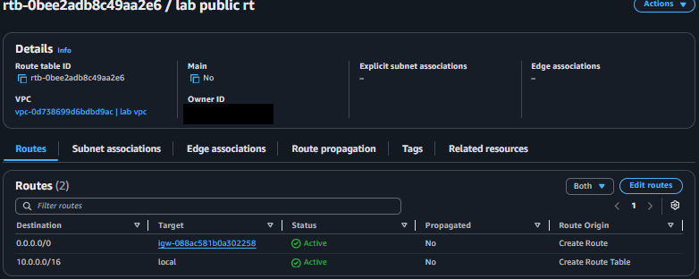

Then I associated that route table with the subnet. Without this step the subnet keeps using the default route table, which has no way out.

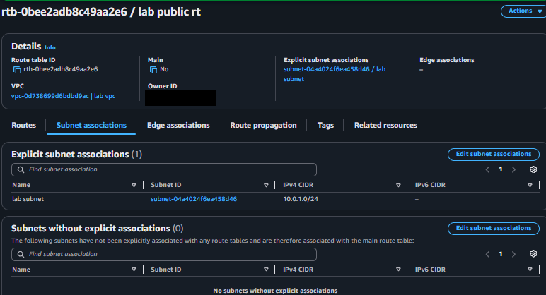

### Part 2: The security group

I created `web sg` in the new VPC with two inbound rules from the start:

- HTTP, port 80, so a browser can load the page
- SSH, port 22, so EC2 Instance Connect works

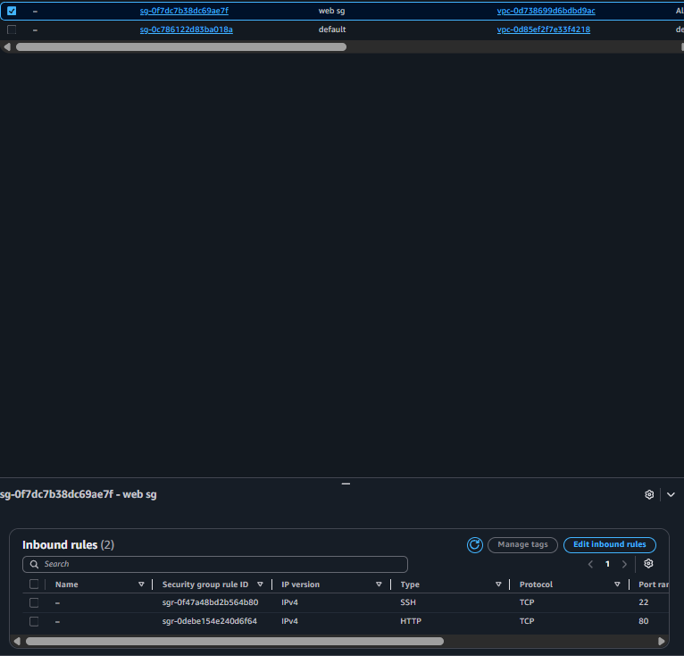

Both rules use Anywhere IPv4 (`0.0.0.0/0`), and the Connect page later warns about it for SSH. That is fine for a short lab, but in a real environment I would restrict SSH to specific IP addresses.

### Part 3: Launching the instance

Name, Amazon Linux AMI, `t3.micro`, and no key pair (I connect through the browser instead).

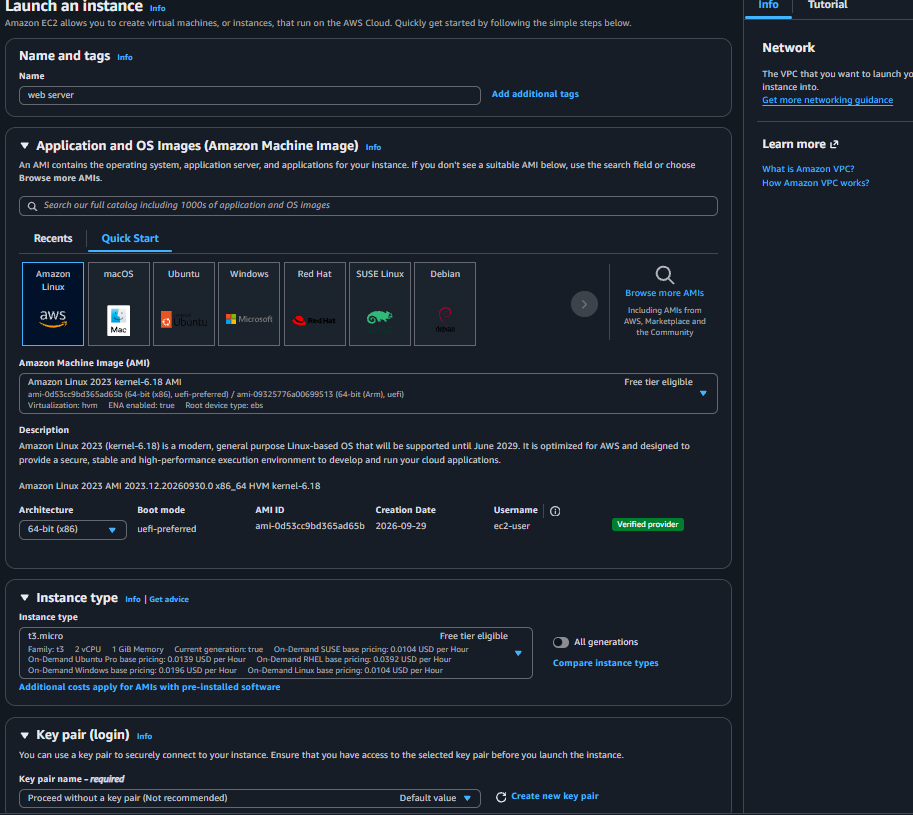

Network settings: the new VPC, the new subnet, auto-assign public IP set to Enable, and the existing `web sg`. Without the public IP the instance has no address to visit.

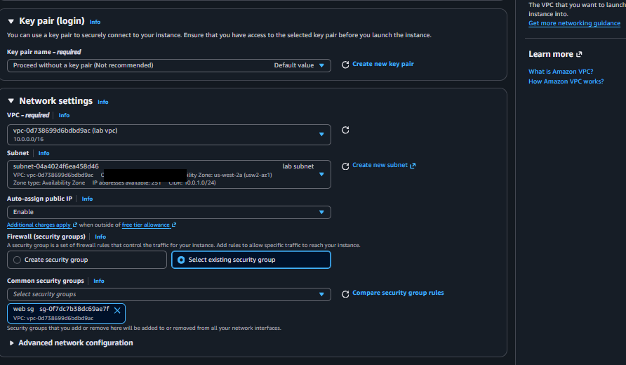

The lab requires a gp2 root volume. The default is gp3, so I switched it manually.

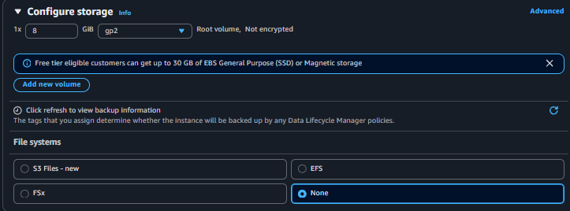

The user data script. It runs once, the first time the instance boots, which is why it has to be set at launch.

```bash
#!/bin/bash
yum install -y httpd
systemctl enable httpd
systemctl start httpd
chmod -R o+w /var/www/html
```

- `yum install -y httpd` installs Apache
- `systemctl enable httpd` makes it start on every boot
- `systemctl start httpd` starts it now
- `chmod -R o+w /var/www/html` gives users write permission on the web root, as the lab requires

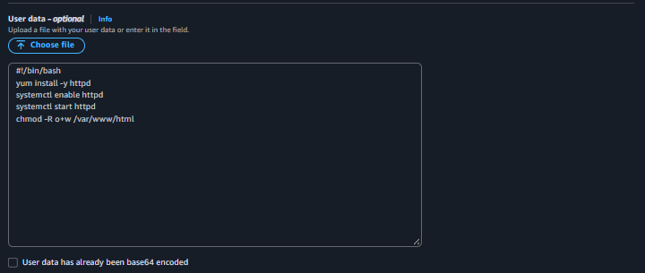

### Part 4: Verifying the install

The system log is the instance's boot diary. It shows `httpd` and its dependencies installing, `Complete!`, and the `httpd.service` symlink created by `systemctl enable`.

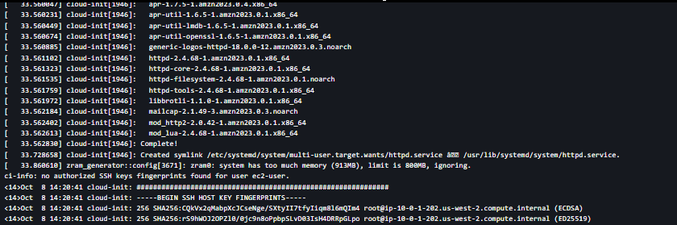

### Part 5: Connecting and deploying the page

I connected with EC2 Instance Connect as `ec2-user`. The warning at the bottom is AWS flagging that port 22 is open to the whole internet.

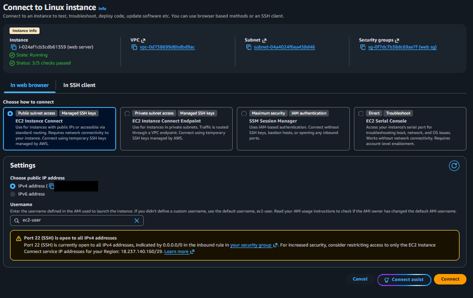

Inside the instance:

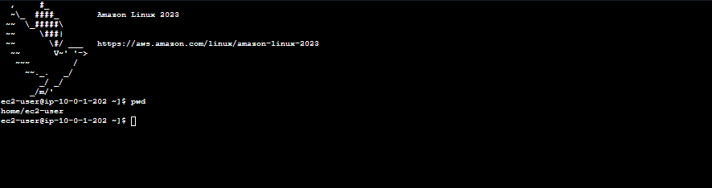

I created `projects.html` in Apache's web root with `sudo nano`. `sudo` is needed because `/var/www/html` is owned by root.

```bash
sudo nano /var/www/html/projects.html
```

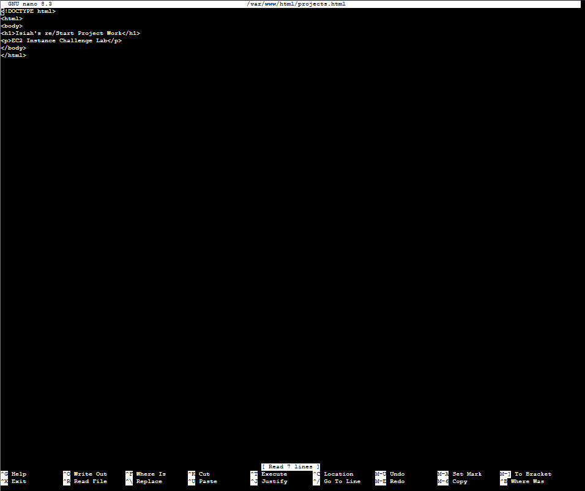

Then confirmed the file landed in the right folder:

```bash
ls -l /var/www/html
```

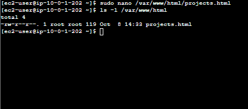

### Result

Opening `http://<public-ip>/projects.html` in a browser returns the page, which proves the full path works: internet gateway, route table, security group on port 80, and Apache.

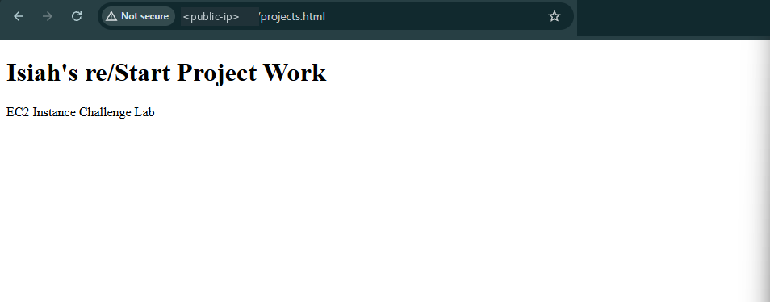

### What I learned

- **Connection refused vs timed out.** Timed out usually means traffic never reached the instance (gateway, route table or security group). Refused means it reached the instance but nothing was listening on that port, like Apache not being installed. On my first attempt I hit refused, so this time I put the Apache install in user data at launch and opened both SSH and HTTP in the security group up front.
- **A route table does nothing until it is associated with the subnet.** Having the right route is only half of it.
- **Auto-assign public IP is easy to miss.** No public IP means no way to reach the instance from the internet.
- **User data only runs at launch.** If it is missing or wrong, you have to fix it on the instance or relaunch.
- **Opening SSH to `0.0.0.0/0` is a real tradeoff.** It worked for the lab, but I would restrict it to known IP addresses anywhere that matters.

### Cleanup

Lab resources disappear automatically when the lab session ends. No keys or credentials are in this repo.

---

## Exercise 3: Troubleshoot Create Instance

### The goal

Launch an EC2 instance with the AWS CLI by running a shell script the lab gives you. The script is broken on purpose, with 2 bugs, and the job is to find and fix both. The server it builds is a LAMP stack running a small cafe web app: Linux, Apache (web server), MariaDB (database) and PHP (the code that builds the pages).

I worked from a "CLI Host" instance the lab provides, configured the AWS CLI with `aws configure`, and made a backup of the script before touching it:

```bash
cd ~/sysops-activity-files/starters
cp create-lamp-instance-v2.sh create-lamp-instance.backup
```

### What the script and user data do

The script looks up the VPC, subnet, key pair and AMI, creates a security group, then calls `aws ec2 run-instances`. The user data file runs on the new server's first boot. It installs Apache, PHP and MariaDB, writes a "Hello From Your Web Server!" page, then downloads the cafe site and sets up its database.

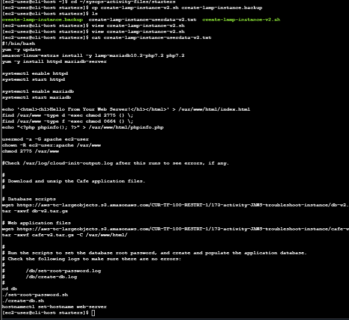

One thing you will see when you run the script is a big wall of `UnauthorizedOperation` errors. That is not a bug. The script checks every AWS region for the VPC, and this lab account blocks every region except `us-west-2` with a service control policy (an organization wide rule). It prints an error for each blocked region, then finds the VPC in `us-west-2`.

### Issue 1: InvalidAMIID.NotFound

**Symptom.** The script found an AMI in `us-west-2`, created a security group, then failed on launch:

```
An error occurred (InvalidAMIID.NotFound) when calling the RunInstances operation:
The image id '[ami-...]' does not exist
```

**Finding it.** Each AWS region has its own list of AMIs, so an ID from one region does not exist in another. The AMI was valid in `us-west-2`, so the launch command had to be asking a different region. I searched the script for every line mentioning the region:

```bash
grep -n "region" create-lamp-instance-v2.sh
```

Every `--region` flag used the `$region` variable the script found earlier, except line 160, inside the `run-instances` command:

```
160:--region us-east-1 \
```

The script even printed "Creating an EC2 instance in us-west-2" (line 155 uses the variable), while line 160 quietly launched in Virginia.

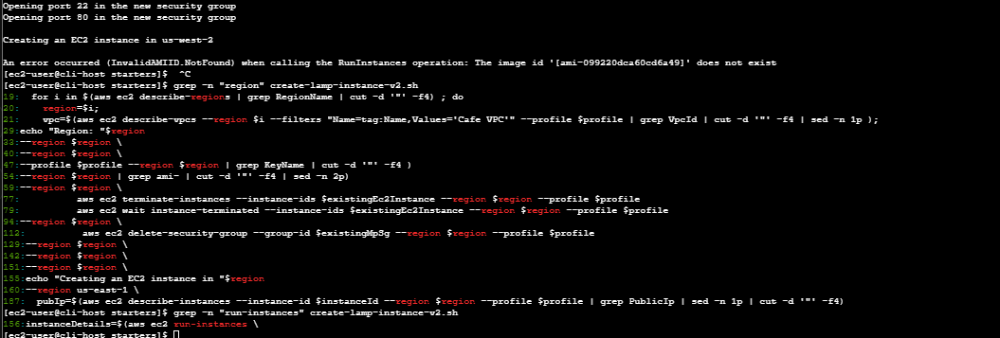

**Fix.** Replace the hard coded region with the variable, then compare against the backup:

```bash
sed -i '160s/us-east-1/$region/' create-lamp-instance-v2.sh
diff create-lamp-instance.backup create-lamp-instance-v2.sh
```

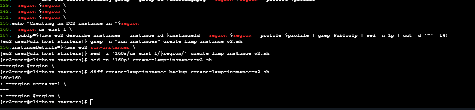

I reran the script. It noticed the security group from the failed run and asked to delete it, and I answered `y`. This time `run-instances` succeeded and printed a public IP.

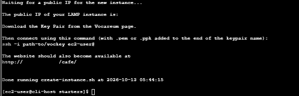

### Issue 2: the web page times out

**Symptom.** The instance existed, but the page would not load. The browser said `ERR_CONNECTION_TIMED_OUT`. A timeout means the request never got an answer, which usually points at a firewall silently dropping traffic. That is different from "connection refused", where the server answers that nothing is listening.

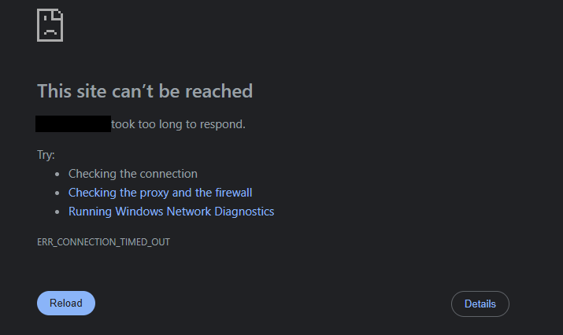

**Finding it.** I installed `nmap` on the CLI Host and scanned the new server. nmap is a port scanner, and it reports each port as open, closed or filtered.

```bash
sudo yum install -y nmap
nmap -Pn <public-ip>
```

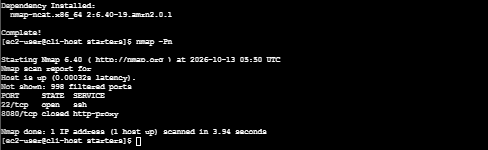

How to read it:
- `22/tcp open`: SSH is reachable
- `8080/tcp closed`: traffic got through the firewall, but nothing is listening
- `998 filtered ports`, including port 80: a firewall silently dropped those

Web pages use port 80, and the script said it opened port 80, but the scan showed 8080 open. I searched the script for the port rules:

```bash
grep -n "port" create-lamp-instance-v2.sh
```

```
145:echo "Opening port 80 in the new security group"
149:--port 8080 \
```

The message says 80, and the command underneath says 8080. One typo, and the security group never allowed port 80.

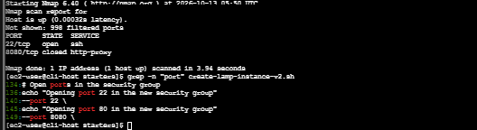

**Fix.**

```bash
sed -i 's/--port 8080/--port 80/' create-lamp-instance-v2.sh
grep -n "port" create-lamp-instance-v2.sh
```

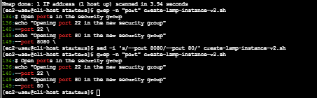

Comparing against the backup now shows both fixes in one view, line 149 (port) and line 160 (region):

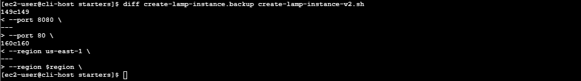

I reran the script, answered `y` to the delete prompts, and it launched a fresh instance with a new public IP.

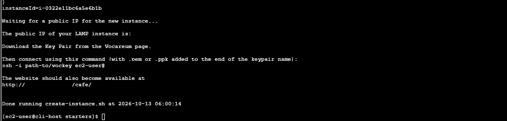

After waiting a couple of minutes for the first boot to finish, `http://<public-ip>` returned the page the user data writes:

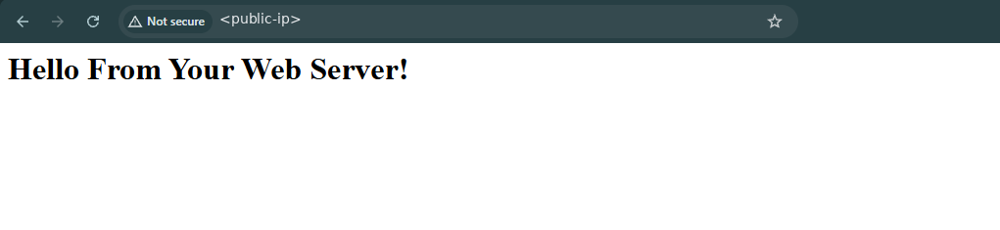

### Verifying the cafe site

The cafe home page loads at `/cafe/`:

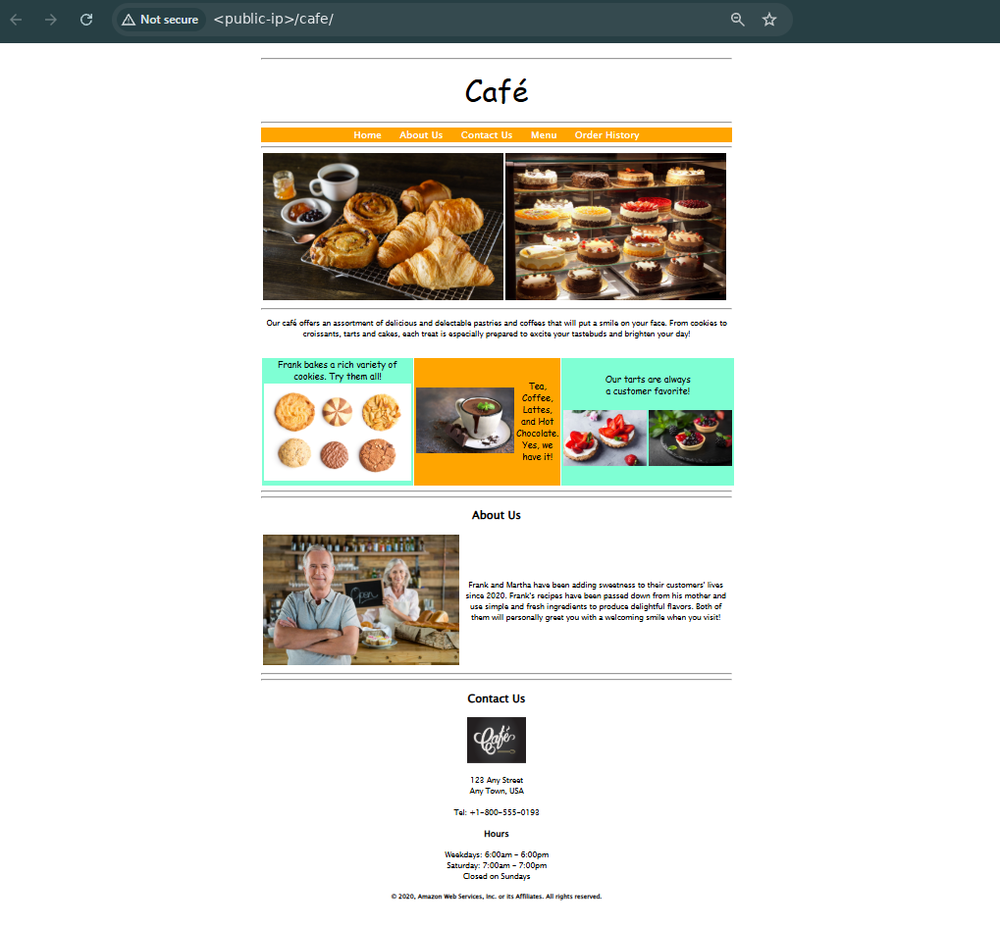

To test the database behind it, I placed an order from the menu. The total came to $74.50 across 9 items.


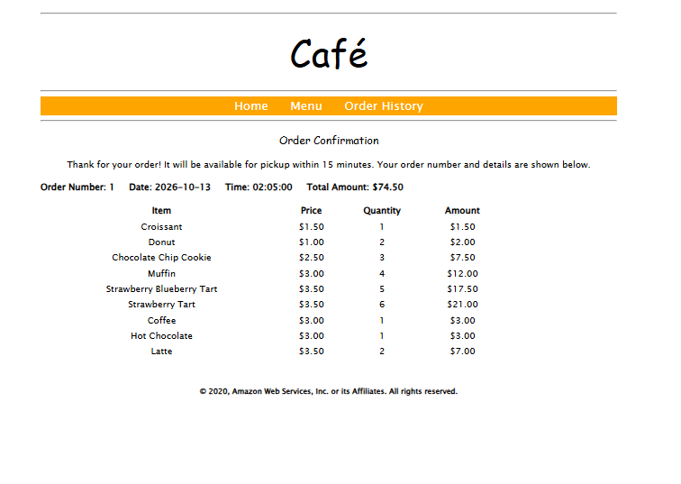

Then I placed a second order (14 donuts, $14.00). Order History lists both, which proves the orders were saved in the MariaDB database and the whole chain works: browser, Apache, PHP, database.

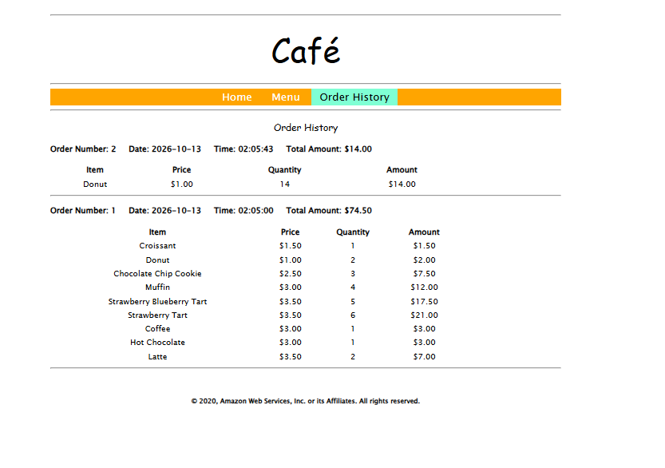

I did not check `cloud-init-output.log` in this run. The working cafe site and database already show the user data script ran.

### What I learned

- **Do not trust the messages a script prints.** Both bugs were places where the script said one thing and the code did another: it announced `us-west-2` but launched in `us-east-1`, and it announced port 80 but opened 8080.
- **`grep -n` is a fast way to find a bad line.** Searching for the thing that looks wrong (`region`, `port`) and scanning for the one line that does not match the rest found both bugs in seconds.
- **Always back up before editing, and use `diff` to prove what changed.** The diff against the backup is a clean before and after.
- **Timeout vs refused vs not resolved are three different problems.** A timeout points at a firewall or security group. Refused means nothing is listening. A name not found error means the address itself could not be looked up.
- **A port scanner shows what a firewall really allows.** nmap showed 8080 open and 80 filtered, which pointed straight at the security group rule.
- **Wait for first boot to finish.** The user data script takes a couple of minutes, and visiting too early can make a working fix look broken.

### Cleanup

Lab resources disappear automatically when the lab session ends. The `aws configure` step uses temporary lab credentials that are never shown here, and no keys or account IDs are in this repo.
