# AWS Lambda: Serverless Reports and a Word Counter

Two small serverless projects on AWS Lambda. The first pulls café sales data from a database and emails a daily report. The second counts the words in any text file uploaded to S3 and emails the result. Both run only when something triggers them, so there is no server to babysit.

**Region:** us-west-2 (Oregon)
**Services:** Lambda, S3, SNS, EventBridge, Systems Manager Parameter Store, IAM, VPC, CloudWatch

---

## Part 1: Daily sales report for a café

### Goal

A café keeps its orders in a MySQL database. I wanted a report of sales per product group to land in the owner's inbox every evening, without anyone logging in to run a query.

### How it fits together

Think of it like a small office. One employee (the data extractor) is the only one allowed to walk into the database room and copy the numbers. A second employee (the report writer) takes those numbers, formats them nicely and hands them to the mail room (SNS), which delivers them. A clock on the wall (EventBridge) tells the report writer when to start.

1. **EventBridge** fires the report function on a schedule.
2. **salesAnalysisReport** reads the database details from Parameter Store, asks the extractor for the data, formats it and publishes it to SNS.
3. **salesAnalysisReportDataExtractor** sits inside the café VPC, queries MySQL and returns the rows.
4. **SNS** emails the report.

### What I did

**1. Packaged the database library as a layer.** Lambda does not ship with the MySQL client library, so I uploaded it once as a layer called `pymysqlLibrary` and attached it to the extractor. A layer is like a shared toolbox: any function can borrow it without carrying its own copy.

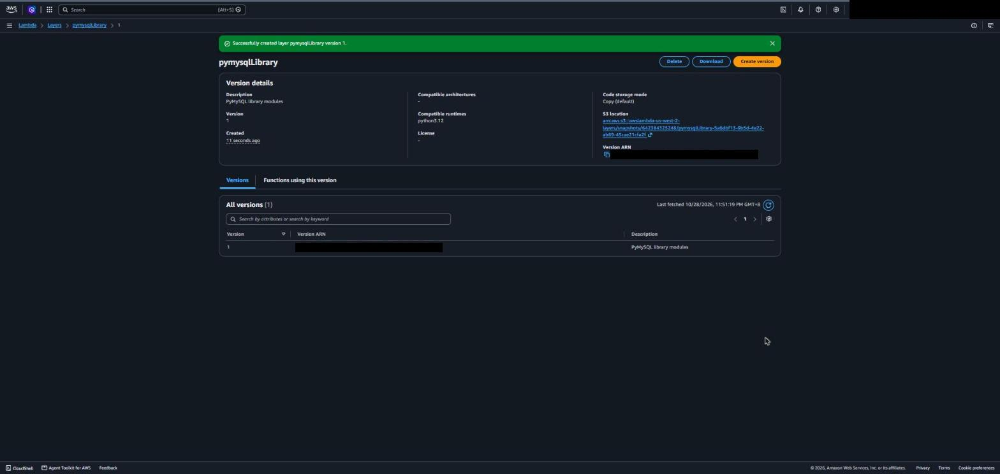

**2. Created the extractor function.** Python 3.12, its own IAM role, the layer attached, and placed in the café's public subnet inside the VPC so it can reach the database. The handler is `salesAnalysisReportDataExtractor.lambda_handler`.

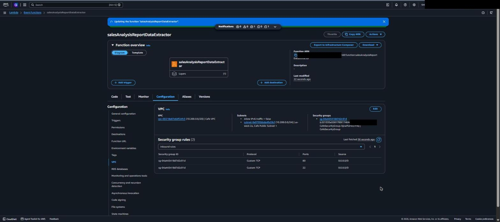

**3. First test failed, on purpose.** The function timed out after 3 seconds. A function inside a VPC is like an employee inside a locked building: the database door was closed to it.

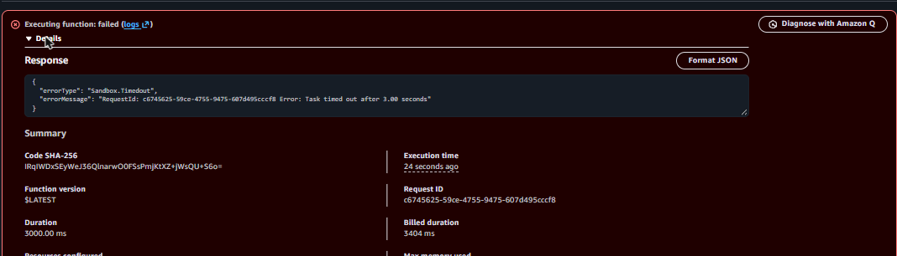

**4. Opened the database port, but only to the VPC.** I added an inbound rule on port 3306 to the café security group. The source is the VPC range (10.200.0.0/20), not `0.0.0.0/0`, so only things inside the network can knock on that door.

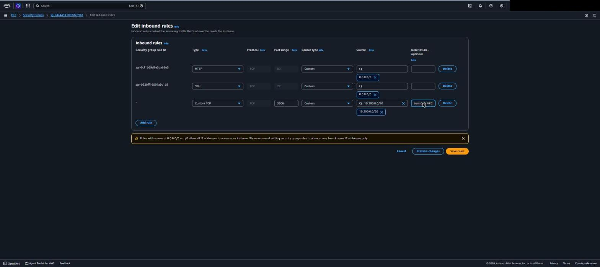

**5. Re-ran the test.** The function returned `statusCode 200`. The first result had an empty body because the data was not loaded yet.

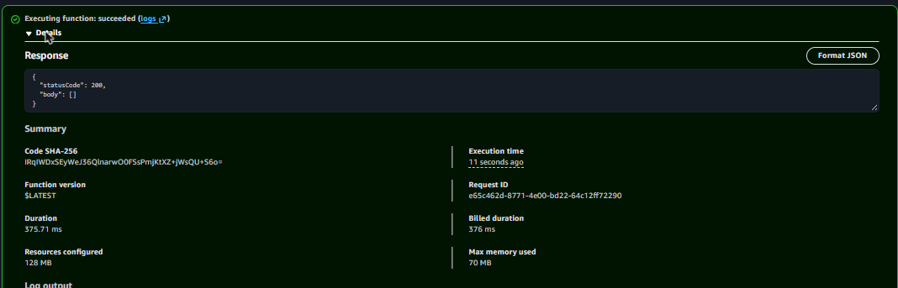

After the café data was in place, the same test returned real rows per product.

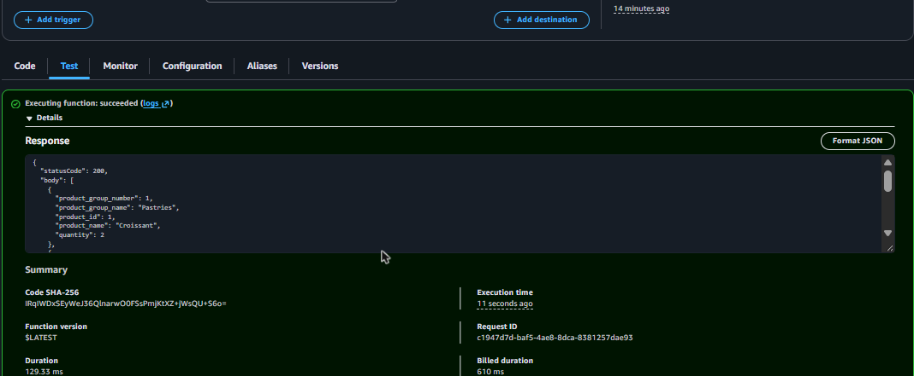

**6. Created the SNS topic.** A Standard topic named `salesAnalysisReportTopic` with a short display name. Then I subscribed my email. An SNS email subscription stays "Pending" until you click the confirmation link, and unconfirmed subscribers silently receive nothing.

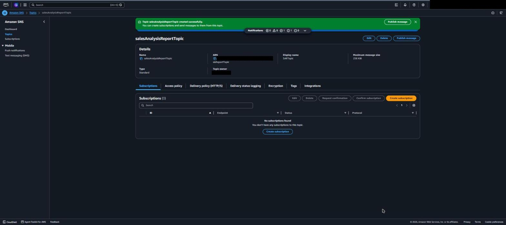

**7. Created the report function.** Python 3.12, its own role, the topic ARN stored in an environment variable (`topicARN`) so the code does not hard code it. I raised the timeout from 3 to 30 seconds because it waits on the extractor.

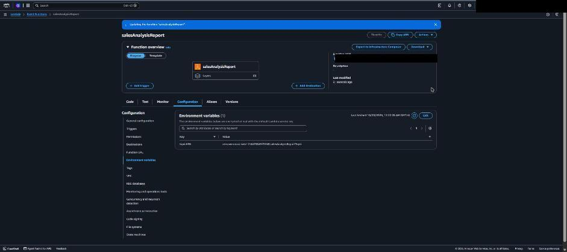

**8. Tested the report end to end.** The function returned `Sale Analysis Report sent.` and the formatted report arrived by email with the subject "Daily Sales Analysis Report".

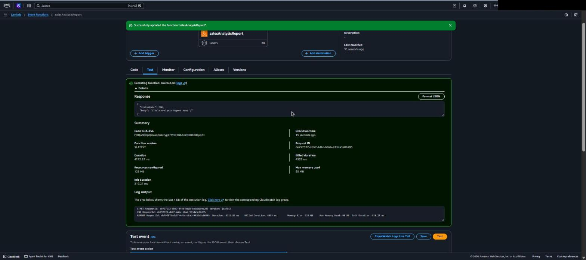

**9. Scheduled it.** An EventBridge rule, `salesAnalysisReportDailyTrigger`, runs `cron(0 20 ? * MON-SAT *)`. EventBridge cron runs in UTC, so I had to convert to the café's local time.

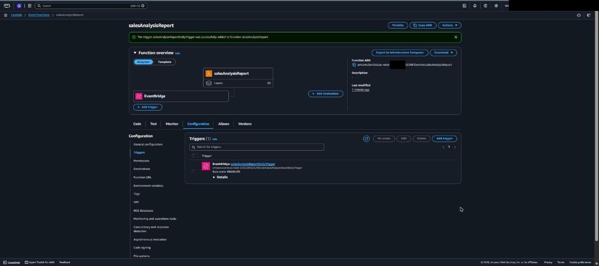

### Troubleshooting

| Problem | Cause | Fix |
|---|---|---|
| Extractor timed out at 3.00 seconds | Port 3306 was closed in the security group | Added an inbound 3306 rule from the VPC range only |
| Report function timed out | Default 3 second timeout, plus cold starts on two functions | Raised the timeout to 30 seconds |
| The café website would not open | Chrome's HTTPS-first mode blocks plain HTTP sites | Opened it in a different browser that allows HTTP for this lab site |
| No email arrived | SNS subscription was still pending | Clicked the confirmation link in the email |
| Needed to update the function code from the command line host | That host had no IAM role and no credentials | Did not paste any keys. Rebuilt the zip from the terminal output and uploaded it through the Lambda console instead |

---

## Part 2: Word counter triggered by S3 uploads

### Goal

Upload a `.txt` file to S3, and automatically get an email saying how many words it has.

- Subject: `Word Count Result`
- Message: `The word count in the <fileName> file is nnn.`

### How it fits together

Dropping a file in the bucket is like dropping a letter in a mailbox with a sensor on it. The sensor (an S3 event) wakes up the function, which reads the letter, counts the words, and sends a note through SNS.

1. A `.txt` file is uploaded to the bucket.
2. S3 sends an event to `WordCountFunction`.
3. The function reads the file, counts the words and publishes to SNS.
4. SNS emails the result.

### The code

```python
import os
import urllib.parse
import boto3

s3 = boto3.client("s3")
sns = boto3.client("sns")

def lambda_handler(event, context):
    # The S3 event tells us which bucket and file triggered the function.
    record = event["Records"][0]["s3"]
    bucket = record["bucket"]["name"]
    key = urllib.parse.unquote_plus(record["object"]["key"])

    # Read the text file and count the words.
    body = s3.get_object(Bucket=bucket, Key=key)["Body"].read().decode("utf-8")
    word_count = len(body.split())

    # Email the result through the SNS topic.
    message = f"The word count in the {key} file is {word_count}."
    sns.publish(
        TopicArn=os.environ["TOPIC_ARN"],
        Subject="Word Count Result",
        Message=message,
    )
    return {"statusCode": 200, "body": message}
```

The full file and the two test files are in [`word-counter/`](word-counter/).

### What I did

**1. SNS topic.** A Standard topic called `WordCountTopic` and an email subscription, confirmed through the link in the email.

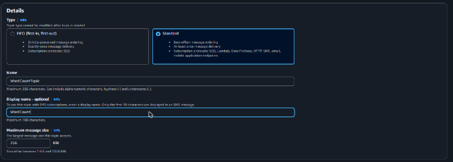

**2. S3 bucket.** `wordcount-uploads-isiah-0412` in the same region, with the default settings and block public access left on. Bucket names are global, so mine needed to be unique.

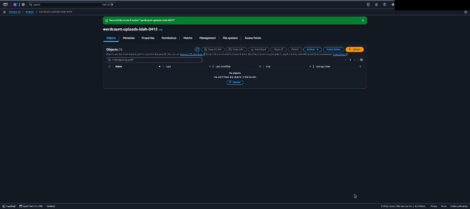

**3. Lambda function.** `WordCountFunction`, Python 3.12, using the existing `LambdaAccessRole` instead of creating a new role. I uploaded the code as a zip and set the environment variable `TOPIC_ARN` to the topic's ARN.

**4. S3 trigger.** Event type: all object create events. Suffix filter: `.txt`, so other file types are ignored. The console makes you tick a recursive invocation acknowledgement, which is a warning against writing results back into the same bucket. This function never writes to S3, so it is safe.

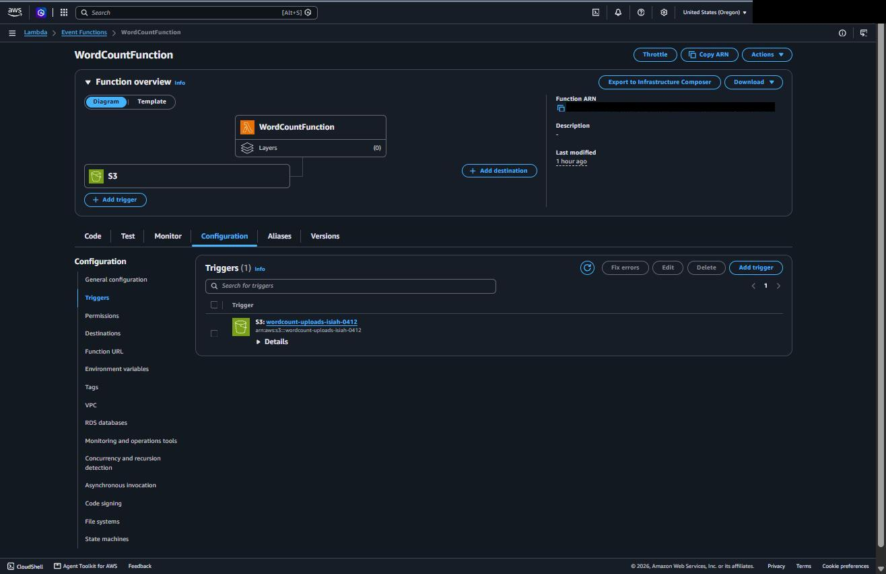

**5. Tested with two files of different lengths.** `sample1.txt` has 23 words and `sample2.txt` has 38.

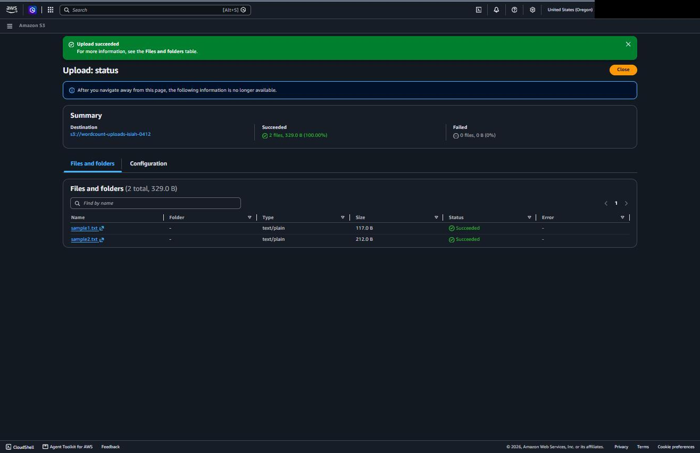

CloudWatch metrics show the function invoked twice per run with zero errors.

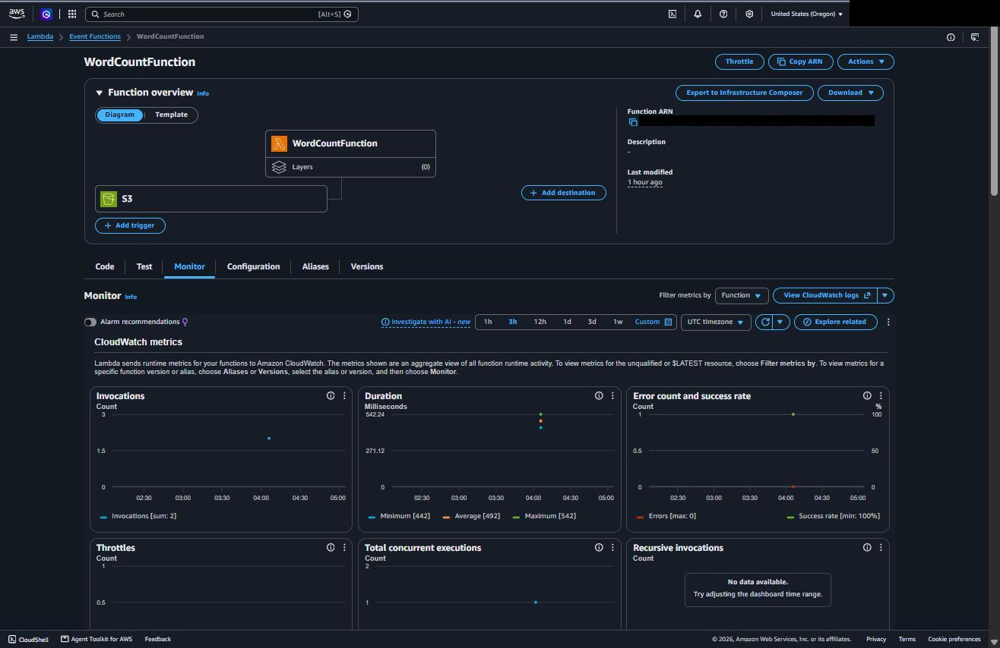

**6. Result.** Both emails arrived with the right subject and the right counts.

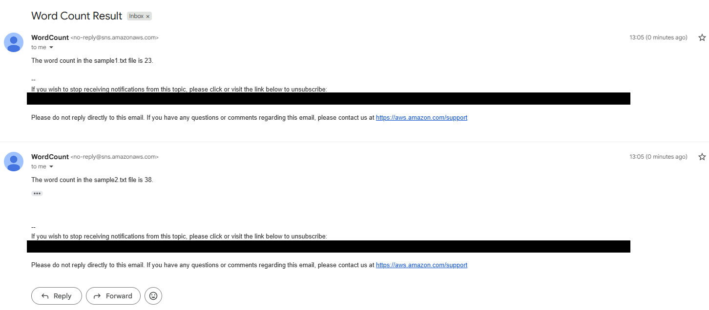

### Troubleshooting

| Problem | Cause | Fix |
|---|---|---|
| First upload sent no email, even though Lambda showed 2 successful runs | The SNS subscription had not been confirmed yet, so SNS had nowhere to deliver | Confirmed the subscription, then uploaded the files again |
| Trigger would not save | Recursive invocation checkbox was not ticked | Ticked it and saved again |
| Lab session expired while I was waiting | The lab environment is temporary, so everything inside it was deleted | Started a fresh lab and rebuilt everything. This is also why the whole setup is scripted and repeatable |

---

## Security notes

- **No secrets in the repo.** I never typed access keys into the terminal or any form. The database password lives in Parameter Store and is passed to the extractor at run time. Screenshots have account IDs, my email and the console header blacked out, and I avoided any screen showing the database password.
- **Least privilege on the network.** The database port is open to the VPC range only, never `0.0.0.0/0`.
- **Known shortcut.** In the word counter, `LambdaAccessRole` came with broad managed policies (full access to S3, SNS and CloudWatch). That was required by the exercise, but in a real project I would narrow it to read access on one bucket and publish access on one topic.
- **Sandboxed labs.** Everything ran in a temporary training account that was deleted when the lab ended.

## What I learned

- Lambda is a function that sleeps until something wakes it up. A trigger can be a schedule (EventBridge) or an event (S3).
- Layers let several functions share one library instead of each carrying a copy.
- A function inside a VPC follows the network's rules, so a timeout often means a closed port, not broken code.
- Environment variables keep things like topic ARNs out of the code.
- SNS email subscriptions need confirmation first, and unconfirmed ones fail silently. Lambda showing "success" does not mean the email was delivered.
- EventBridge schedules run in UTC.
- Temporary lab environments disappear, so documenting as I go and keeping the code in files saved me when I had to rebuild.
