# Custom VPC from Scratch

Built a network from nothing: a VPC with a public subnet, a private subnet, an internet gateway, a bastion host and a NAT gateway so private resources can reach the internet without being reachable from it.

## The idea (newbie version)

Think of a VPC as your own fenced-off piece of land inside AWS. Inside it you build two buildings:

- **Public subnet**: the storefront. It has a door to the street (internet gateway), so visitors can walk in.
- **Private subnet**: the back office. No door to the street. Staff can still phone out (through the NAT gateway), but nobody outside can call in.
- **Bastion host**: the security guard at the storefront. The only way into the back office is to go through him.

## Architecture

```
Internet
   |
[Internet Gateway]
   |
Public Subnet 10.0.0.0/24  ---- Bastion Server, NAT Gateway
   |
Private Subnet 10.0.2.0/23 ---- private workloads (route 0.0.0.0/0 -> NAT)
        (all inside Lab VPC 10.0.0.0/16)
```

## What I built

1. **VPC** `Lab VPC` with CIDR `10.0.0.0/16`, DNS hostnames turned on.
2. **Two subnets**: `Public Subnet` (`10.0.0.0/24`) and `Private Subnet` (`10.0.2.0/23`) in the same Availability Zone.
3. **Internet gateway** created and attached to the VPC.
4. **Public route table** with `0.0.0.0/0 -> internet gateway`, associated with the public subnet. This route is what actually makes a subnet "public".
5. **Bastion server** (Amazon Linux 2023, t3.micro) in the public subnet with auto-assigned public IP and its own security group.
6. **NAT gateway** in the public subnet with an Elastic IP, plus a `0.0.0.0/0 -> NAT` route in the private route table.

## Screenshots

| Step | Image |
|---|---|
| Create the VPC | 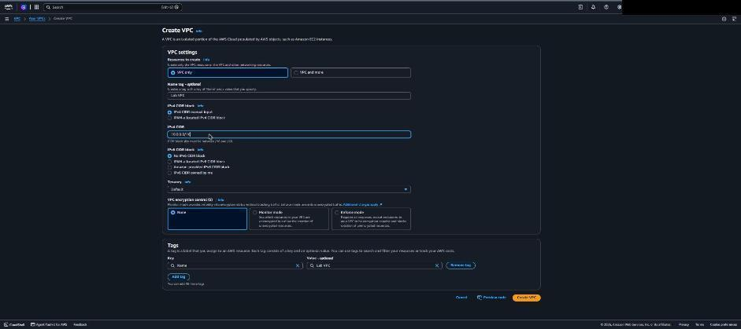 |
| VPC available | 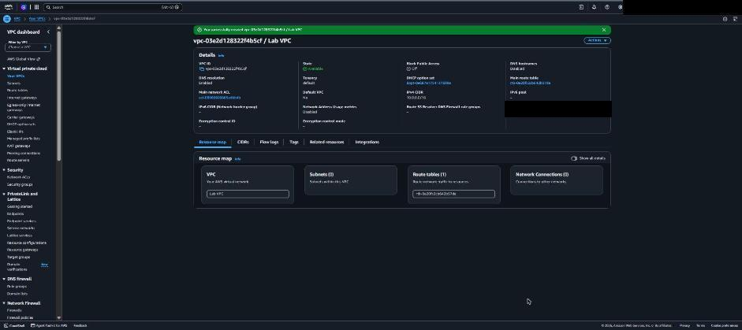 |
| Subnet form | 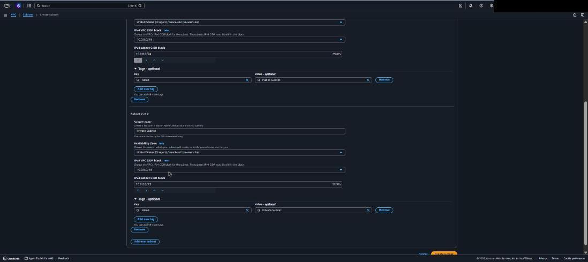 |
| Both subnets created | 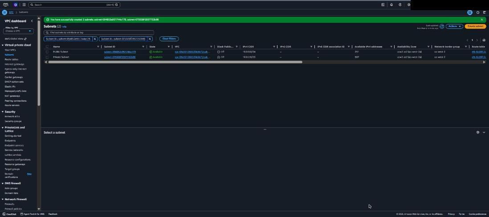 |
| Internet gateway attached | 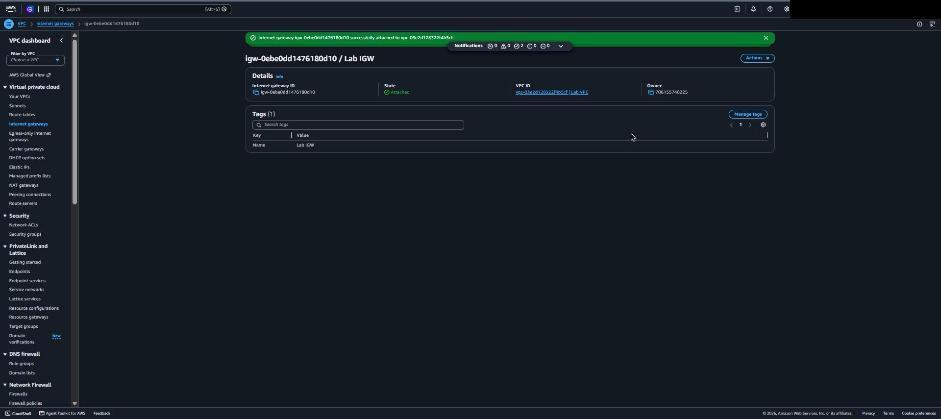 |
| Public route table with internet route | 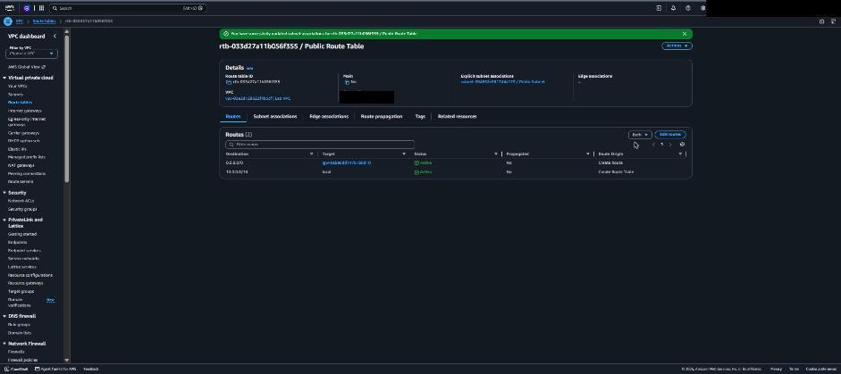 |
| Bastion security group | 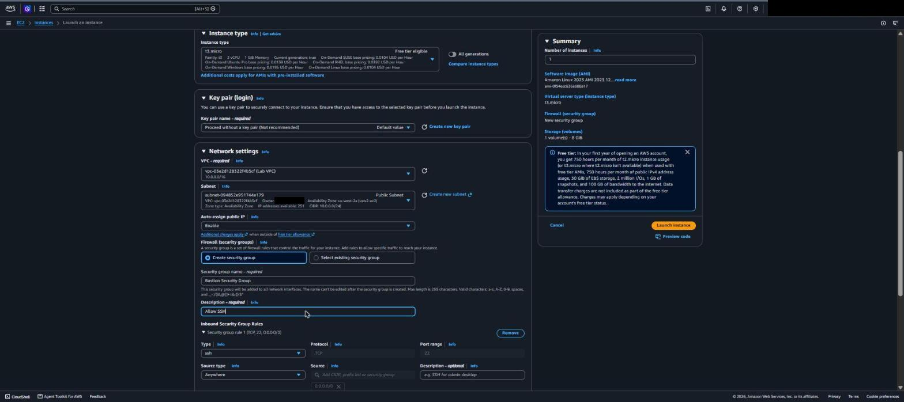 |
| NAT gateway form | 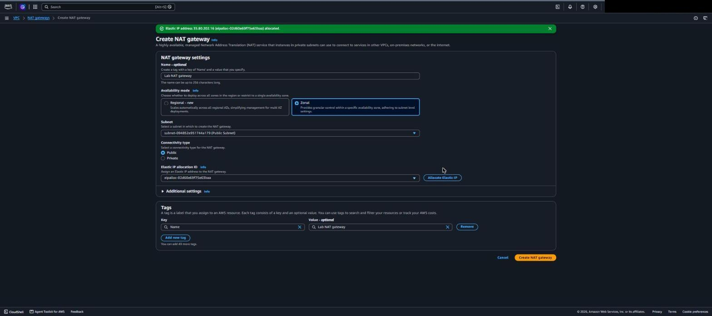 |
| NAT gateway created | 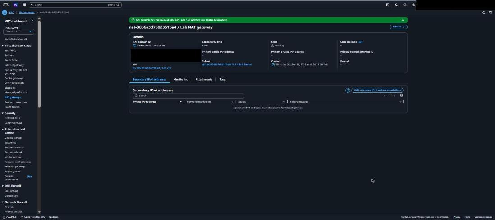 |
| Private route to NAT | 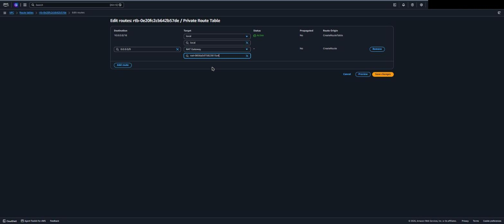 |
| Private route saved | 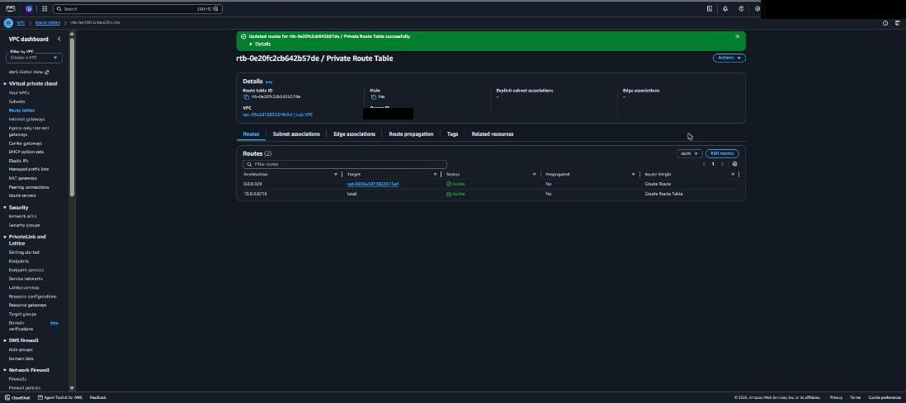 |

## Key concepts

- **Public vs private is just routing.** A subnet is public only because its route table sends `0.0.0.0/0` to an internet gateway.
- **Internet gateway** gives two-way internet access. **NAT gateway** gives one-way: private instances can start connections out, nothing can start connections in.
- **The NAT gateway lives in the public subnet.** It needs the internet gateway route to reach the internet itself.
- **Elastic IP** is a fixed public address the NAT gateway uses to talk to the world.

## Security notes

- The bastion security group allows SSH from anywhere because the exercise requires it. In production I would restrict the source to my own IP or a corporate range, or skip SSH entirely and use SSM Session Manager.
- No key pair was attached; access would go through EC2 Instance Connect.
- Account IDs and emails are blacked out in the screenshots.

## Issues I hit

| Problem | Fix |
|---|---|
| `Credentials do not match current AWS Account` in the console | Logged out of the stale console session and reopened it from the lab page |
| NAT gateway form looked different from the guide (Regional vs Zonal) | Picked **Zonal** so I could place it in the specific public subnet |
| Create button moved after typing the tag | Re-checked the screen before clicking |

## What I learned

How traffic really flows in a VPC, why route tables define public and private, and how a NAT gateway lets private resources patch themselves while staying unreachable from the internet.
