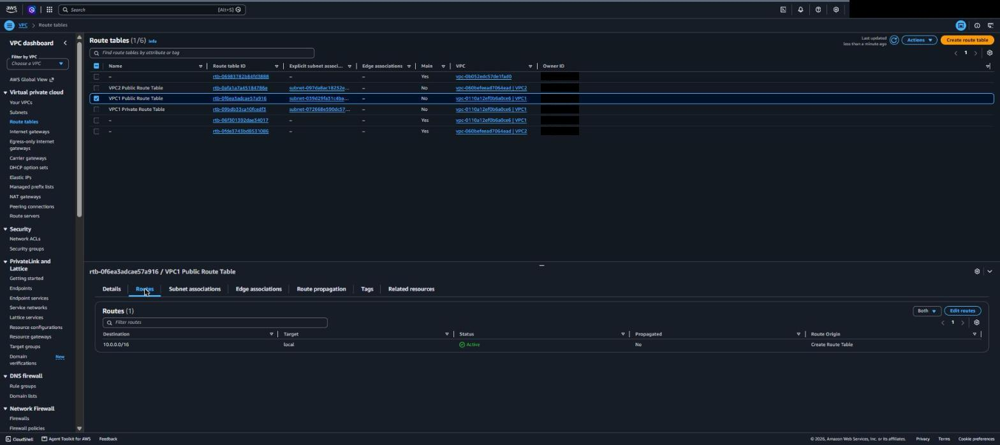
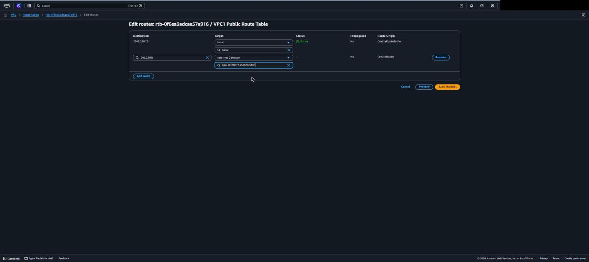
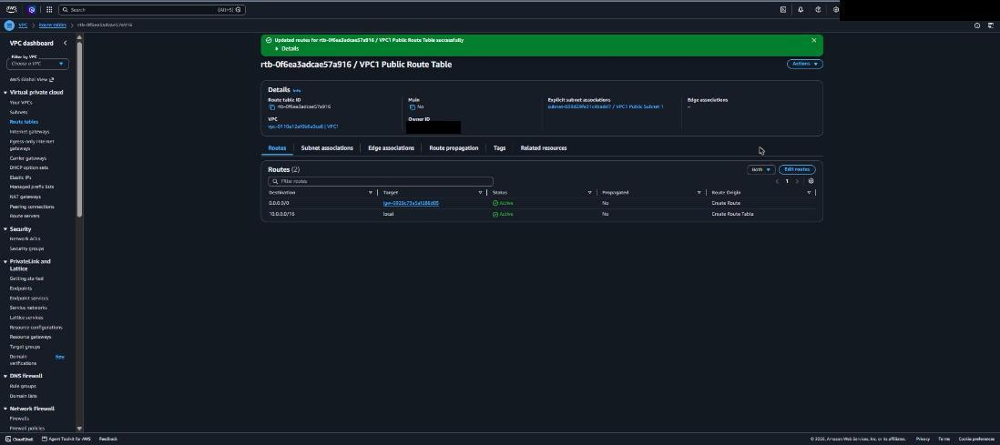
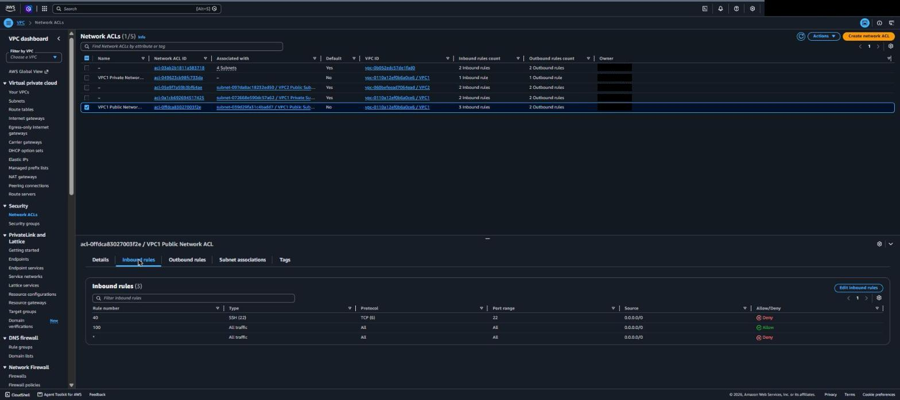
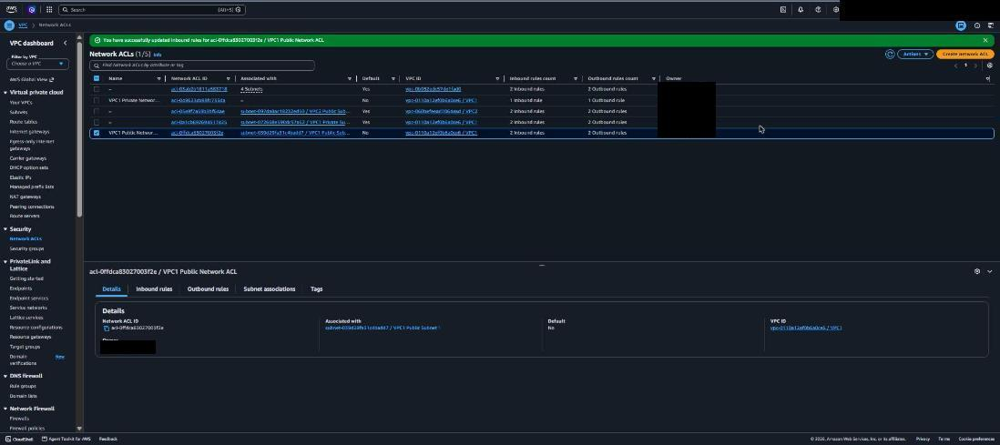

# Troubleshooting a Broken VPC

A café web server was running but unreachable. I tracked the problem down layer by layer and fixed two separate network faults: a missing internet route and a network ACL rule that blocked SSH.

## The idea (newbie version)

Imagine a shop that is open but nobody can get in. You check the doors in order:

1. **Is there a road to the shop?** That is the **route table**. No road, no customers.
2. **Is the building's gatekeeper letting people through?** That is the **security group**.
3. **Is the neighbourhood checkpoint letting people through?** That is the **network ACL**, a second filter at the subnet level.

Any one of these can silently block traffic. Troubleshooting means checking each layer from the outside in.

## Architecture

```
Client -> Internet Gateway -> Route table -> Network ACL -> Security group -> Cafe web server
                                (VPC1, public subnet 10.0.1.0/24)
```

A second VPC (VPC2) held a CLI host used for investigation.

## What I found and fixed

| # | Layer | Fault | Fix |
|---|---|---|---|
| 1 | Route table | The public subnet's route table had only the local route. No path to the internet gateway, so it was not really public. | Added `0.0.0.0/0 -> Internet Gateway` |
| 2 | Network ACL | Inbound rule 40 explicitly **denied** SSH (port 22) from anywhere, and it sat before the allow-all rule 100. | Removed the deny rule |

Rule order matters on a network ACL: rules are checked from the lowest number up and the first match wins, so a deny at 40 beats an allow at 100.

The security group for the web server already allowed HTTP and SSH, so it was not the culprit.

## Screenshots

| Step | Image |
|---|---|
| Public route table: only the local route |  |
| Adding the internet route |  |
| Route table fixed |  |
| Network ACL with the SSH deny rule |  |
| Network ACL after removing the rule |  |

## Troubleshooting method

1. Confirm the instance is running and healthy (status checks pass).
2. Check what the instance's **security group** allows.
3. Check the **route table** for the subnet: does a public subnet have an internet gateway route?
4. Check the **network ACL** for the subnet: look for deny rules and rule order.
5. Retest after each single change so you know which fix mattered.

## Notes and limits

- I did this entirely from the console. The lab's suggested flow-log analysis step uses the CLI and an S3 bucket; the lab's permissions blocked creating the bucket from the console, so I skipped the flow-log analysis. VPC Flow Logs record accepted and rejected traffic per network interface and would have shown the denied SSH attempts.
- Account IDs and emails are blacked out in the screenshots.

## What I learned

Connectivity problems are layered. Routes decide whether a path exists, network ACLs filter at the subnet edge (stateless, ordered), and security groups filter at the instance (stateful). Checking them in order beats guessing.
