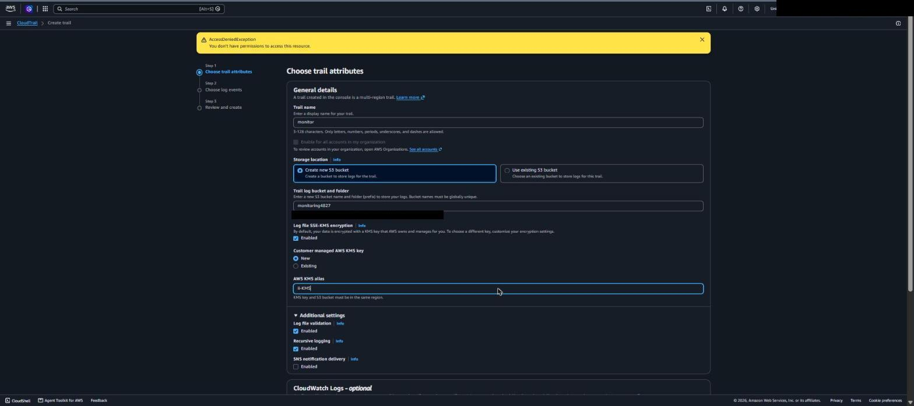
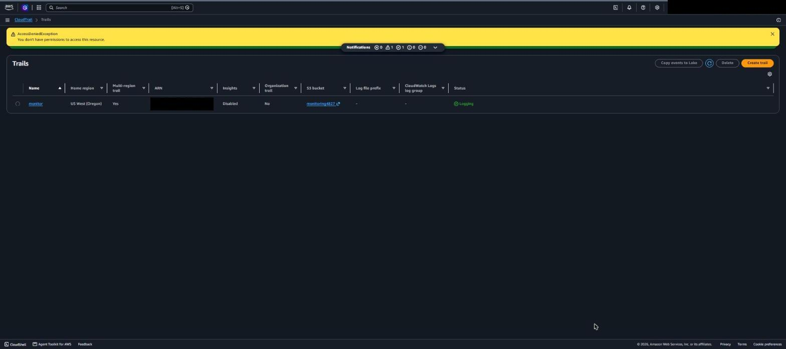
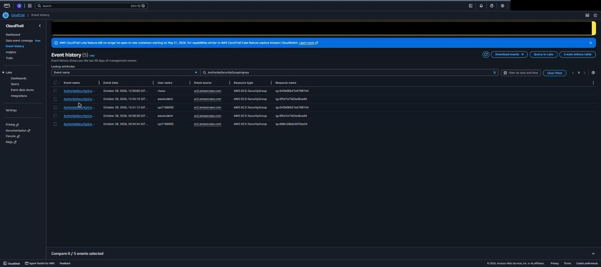
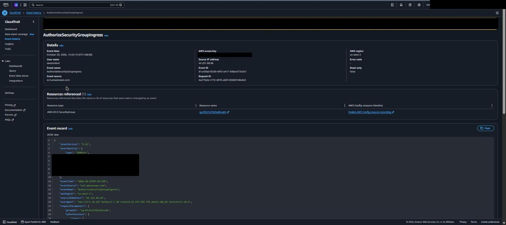
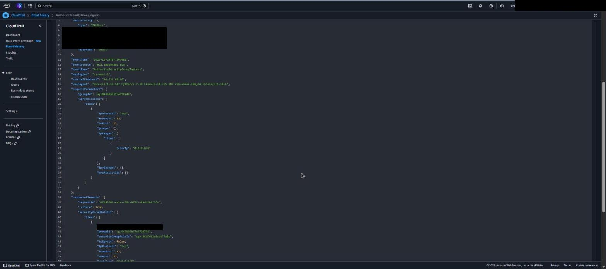

# Investigating a Hacked Website with AWS CloudTrail

Turned on CloudTrail, then used its logs to find out who opened SSH to the whole internet on a café web server and where the request came from.

## The idea (newbie version)

CloudTrail is the security camera for your AWS account. Every action (launching a server, changing a firewall rule) gets written down: who did it, when, from which IP address, and with which tool. If something suspicious happens, you rewind the tape.

## What I built

1. A **trail** named `monitor` that records all management events (reads and writes) in every region, with log files stored in a new S3 bucket, encrypted with a new KMS key and with log file validation on.
2. After the trail was on, a simulated attacker changed a security group. I searched **Event history** for the `AuthorizeSecurityGroupIngress` API call, which is the call that adds a firewall rule.

## What the logs showed

| Field | Value |
|---|---|
| Event | `AuthorizeSecurityGroupIngress` |
| Who | IAM user `chaos` |
| What changed | Port 22 (SSH) opened to `0.0.0.0/0` on the web server's security group |
| From where | The café web server's own public IP |
| Tool | `aws-cli` (user agent), meaning someone ran CLI commands from inside the server |

The earlier event from the `awsstudent` user, also coming from the web server's IP, showed credentials were being used from the server itself. Taken together: the attacker got onto the web server and used the AWS credentials found there.

## Screenshots

| Step | Image |
|---|---|
| Create the trail |  |
| Trail is logging |  |
| Event history filtered to security group changes |  |
| First suspicious event |  |
| The hacker's event record |  |

## Security notes and lessons

- **Turn CloudTrail on before you need it.** It only records from the moment it is enabled.
- **Never leave long-lived access keys on servers.** Use IAM roles for EC2 so there is no key to steal.
- **Least privilege:** a web server should not be able to change security groups at all.
- **SSH from `0.0.0.0/0` is dangerous.** Restrict it to known IPs or use Session Manager.
- Cleanup steps the lab suggests (removing the rogue user, tightening the rule) are the follow-up; I stopped after the investigation and did not delete anything.
- I used the console's Event history instead of the lab's command-line `grep` and Athena queries. Athena would let you run SQL over the full log files in S3, which is the better tool for large accounts.
- Account IDs, access keys, ARNs and emails are blacked out in the screenshots.

## What I learned

How to read a CloudTrail event (identity, source IP, user agent, request parameters) and how to trace a change back to its actor.
