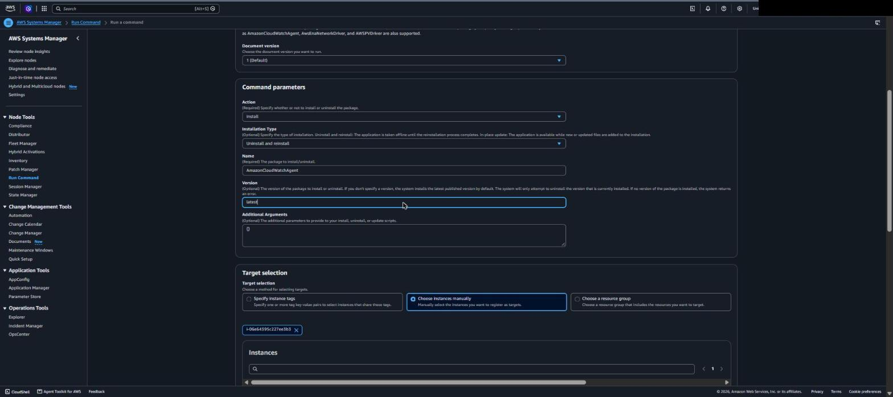

# Monitoring a Web Server with CloudWatch

Installed the CloudWatch agent on an EC2 web server, shipped its web logs and memory stats into CloudWatch, then built a metric filter and an alarm that fires when the site returns too many 404 errors.

## The idea (newbie version)

By default AWS can see a server from the outside, like a security guard watching the front door. It can tell you how busy the CPU is, but not how much memory is free or what the website itself is logging. The **CloudWatch agent** is a small program you place inside the server, like a night shift worker who reports what is happening in the building. Then you can set rules on what they report:

- **Log group**: a folder in CloudWatch where the server's log files land.
- **Metric filter**: a rule that scans the logs and counts a pattern, here "every 404 Not Found".
- **Alarm**: a tripwire on that count. Too many 404s in a minute and it goes into the "In alarm" state.

## What I built

1. **Installed the agent** with Systems Manager Run Command (`AWS-ConfigureAWSPackage`, package `AmazonCloudWatchAgent`). No SSH needed, Systems Manager talks to the instance through its IAM role.
2. **Stored the agent config** as a Parameter Store parameter (`Monitor-Web-Server`). It tells the agent to collect Apache `access_log` and `error_log`, plus CPU, disk, disk IO, memory and swap every 10 seconds.
3. **Applied the config** with Run Command (`AmazonCloudWatch-ManageAgent`: action `configure`, source `ssm`, restart `yes`).
4. **Created a metric filter** on the `HttpAccessLog` log group with this pattern, which matches access log lines whose status code is 404:
   `[ip, id, user, timestamp, request, status_code=404, size]`
   It publishes a count of `1` per match to metric `404Errors` in namespace `LogMetrics`.
5. **Created an alarm** `404 Errors`: `404Errors >= 5` for 1 datapoint within 1 minute, with an SNS topic as the action.
6. **Triggered it** by requesting pages that do not exist on the web server (seven of them). A minute or two later the alarm went to **In alarm**.
7. **Checked the in-instance metrics** under the `CWAgent` namespace: memory used percent and swap used percent showed up (about 14 percent memory), plus disk metrics, which the default EC2 metrics do not provide.

## Screenshots

| Step | Image |
|---|---|
| Installing the agent through Run Command |  |

I only kept this one screenshot. My screenshot capture stopped saving files partway through the lab, so the alarm and graph screenshots are not in the repo. The results above were all checked live in the console (alarm state, log events, `CWAgent` metrics).

## Things I did differently from the guide

- **No email subscription on the SNS topic.** The console's "create new topic" shortcut forces you to type an email address, so I created an empty SNS topic first (`Web-404-Alerts`) and pointed the alarm at its ARN. The alarm still changes state, it just has nobody to notify. In real life you would subscribe a team mailbox or a chat integration.
- Run Command defaults to writing output to S3; I turned that off because the lab permissions do not allow creating buckets.

## Issues I hit

| Problem | Fix |
|---|---|
| Alarm stayed on "Insufficient data" | My first test requests went to a wrong IP address left over in my browser, so nothing reached the log. I took the public IPv4 from the instance details and sent the 404s there |
| The alarm form could not use the new topic from its dropdown list | Switched to "Use topic ARN" and pasted the topic's ARN |

## Notes

- Metric filters only count log lines that arrive after the filter exists, so create the filter first and then generate traffic.
- The log stream also showed random internet scanners poking the server within minutes of it being online. Anything public gets probed immediately, which is a good reason to alarm on error spikes.
- Account IDs, emails and access keys are blacked out in the screenshot.

## What I learned

How to get visibility inside a server, not just around it: ship logs and metrics with the agent, turn a log pattern into a number with a metric filter, and put an alarm on that number.
